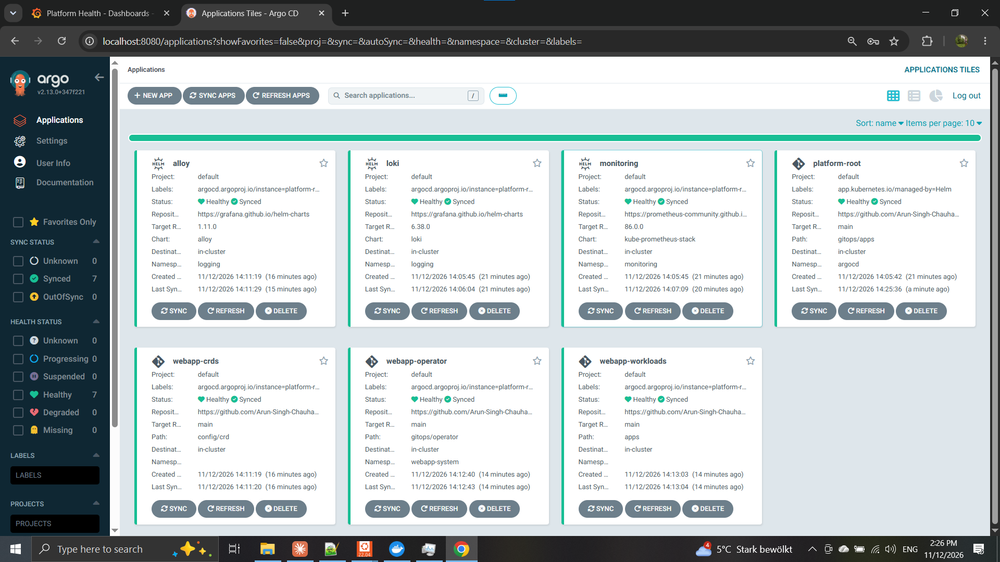
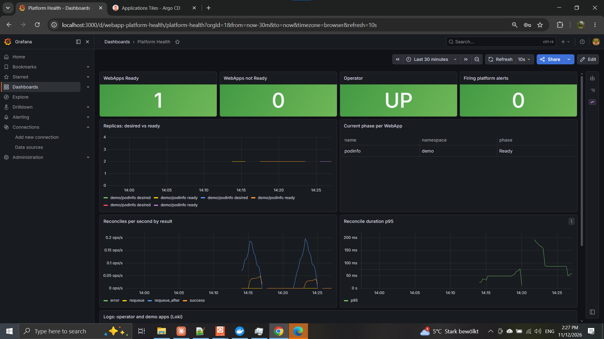

# webapp-operator

[](https://github.com/Arun-Singh-Chauhan-09/springer-nature-webapp-operator/actions/workflows/ci.yaml)

> Personal portfolio project built for a Springer Nature Platform Engineer application. Not affiliated with or endorsed by Springer Nature.


A small internal-developer-platform built around a Kubernetes operator in Go.
Product teams write a six-line `WebApp`; the platform turns it into a secure,
observable Deployment and Service, reports status back, and heals itself.

> Built as a platform-engineering showcase for the Springer Nature
> Platform Engineer role (Engineering Enablement): platform as a product,
> self-service, Kubernetes operators, observability and reliability drills.

```yaml
apiVersion: platform.example.com/v1
kind: WebApp
metadata:
  name: podinfo
  namespace: demo
spec:
  image: ghcr.io/stefanprodan/podinfo:6.7.1
  replicas: 2
  port: 9898
  healthPath: /healthz
```

```
$ kubectl -n demo get webapp
NAME      IMAGE                                DESIRED   READY   PHASE   AGE
podinfo   ghcr.io/stefanprodan/podinfo:6.7.1   2         2       Ready   1m
```

## What the platform adds for free

| The developer writes | The platform adds |
|---|---|
| `image` | Rejects `:latest` and untagged images at the API server (CEL) |
| `port` | Named container port + ClusterIP Service |
| `healthPath` | Readiness and liveness probes |
| (nothing) | CPU/memory requests and limits, non-root, seccomp `RuntimeDefault`, no privilege escalation, all capabilities dropped, no SA token mount |
| (nothing) | `app.kubernetes.io/*` labels for observability |
| (nothing) | Status: `Progressing` → `Ready`, or `Degraded` with the reason (e.g. `ImagePullBackOff`) |
| `needsDatabase` | Reported as a condition today; CloudNativePG provisioning on the roadmap |

## Quick start

Requirements: Docker, [kind](https://kind.sigs.k8s.io/), kubectl, make, bash.
On Windows, run everything from **WSL2** (Ubuntu) with Docker Desktop's WSL integration on.
Go is **not** required locally: it runs inside Docker.

```bash
make up          # kind cluster + build/load operator + CRD + sample app, waits until Ready
make status      # WebApps and their children
make drill-all   # run failure drills, prints a PASS/FAIL report
make test        # go vet + unit tests (in a golang container)
make down        # delete the cluster
```

Try the guardrails:

```bash
kubectl apply -f apps/examples/rejected-latest-tag.yaml   # rejected: ':latest' not allowed
kubectl apply -f apps/examples/with-database.yaml         # DatabaseReady=Unknown condition
kubectl -n demo describe webapp podinfo                   # conditions + events
make metrics                                              # webapp_ready, webapp_phase, ...
```

## GitOps mode (Terraform + ArgoCD)

The same platform, but nothing is applied by hand. Terraform builds the cluster and
installs ArgoCD plus one root Application; ArgoCD pulls everything else from this repo.

```
terraform (infra/envs/kind)
  ├─ kind cluster
  └─ module platform-bootstrap ── ArgoCD (Helm) + root Application "platform-root"
                                        │  app-of-apps: gitops/apps/
                                        ├─ wave -2  monitoring        kube-prometheus-stack (Prometheus, Alertmanager, Grafana)
                                        ├─ wave -2  loki              Loki single binary
                                        ├─ wave -2  cert-manager      TLS for the admission webhook
                                        ├─ wave -1  alloy             Grafana Alloy: pod logs -> Loki
                                        ├─ wave -1  webapp-crds       config/crd
                                        ├─ wave  0  webapp-operator   gitops/operator: operator + policy webhook, ServiceMonitor, alerts, dashboard
                                        └─ wave  1  webapp-workloads  apps/*.yaml
```

```bash
make gitops-up       # terraform apply, then wait until ArgoCD reports every wave Healthy
make gitops-status   # ArgoCD Applications (sync + health) and WebApps
make argocd-ui       # admin password + UI on http://localhost:8080
make gitops-drills   # D1 self-heal + D5 GitOps drift + D6 alerting
make grafana-ui      # Grafana on http://localhost:3000, dashboard "Platform Health"
make alerts          # alerts currently active in Alertmanager
make gitops-down     # terraform destroy
```



Design choices:

- **Terraform stops at the bootstrap.** It owns the cluster, ArgoCD and the root app only. Workloads are owned by Git, so there is one source of truth per layer and no Terraform/ArgoCD fight over the same objects.
- **One reusable module.** `infra/modules/platform-bootstrap` is shared by every environment; `infra/envs/kind` today, `infra/envs/eks` in Phase 5.
- **Sync waves that actually wait.** ArgoCD no longer health-checks `Application` resources, so the module adds a Lua health check for them, plus one for `WebApp` (Ready → Healthy, Degraded → Degraded). A broken release shows up red in the ArgoCD UI, not only in `kubectl`.
- **Immutable image promotion.** CI publishes `ghcr.io/arun-singh-chauhan-09/webapp-operator:sha-<commit>` on every push to `main`; `make pin-image` pins `gitops/operator/kustomization.yaml` to that tag, and the Git commit is the deployment. Rollback = `git revert`.

## Workload policy (admission webhook, from my MEng thesis)

My MEng thesis, *Security and Deployability of LLM-Generated Kubernetes Manifests*,
scanned 720 generated manifests with Trivy and found that workload manifests almost
never came out clean. This webhook enforces the same Trivy checks (KSV IDs) at the
API server, so an unsafe manifest is stopped at `kubectl apply`, whoever or whatever wrote it.

| Action | Checks |
|---|---|
| **Deny** | privileged (KSV017), host network/PID/IPC (KSV009/010/008), hostPath (KSV023), privilege escalation (KSV001), may run as root (KSV012), SYS_ADMIN (KSV005), `:latest` or untagged image (KSV013) |
| **Warn** | no CPU/memory limit (KSV011/018), writable root filesystem (KSV014), capabilities not dropped (KSV003), no seccomp profile (KSV030), other added capabilities (KSV022) |

```text
$ kubectl apply -f unsafe.yaml
Error from server (Forbidden): admission webhook "enforce.workload-policy.platform.example.com" denied the request:
denied by platform policy (Trivy KSV checks): [KSV009] uses the host network (hostNetwork: true);
[KSV023] mounts hostPath "/" as volume "host"; [KSV017] container "app": runs privileged ...
```

- **Why not just Pod Security Admission?** PSA checks Pods, so a dangerous Deployment is
  accepted and its pods silently fail to appear. The webhook rejects the Deployment itself,
  names the checks, and also covers image tags and limits, which PSA does not.
- **Opt-in per namespace** with `platform.example.com/policy: enforce` or `warn`; warn mode
  reports everything and blocks nothing, for rolling it out to existing teams.
- **The paved road passes its own policy:** a unit test fails if a change to the operator's
  defaults would make WebApp Deployments violate a deny rule.
- TLS from cert-manager; ArgoCD ignores the injected `caBundle` so the two do not fight.
- Decisions and findings are Prometheus metrics, shown on the Platform Health dashboard.

Code: `internal/policy` (rules, pure Go, table-tested), `internal/workloadpolicy` (handler),
`config/webhook` (certificate, Service, ValidatingWebhookConfiguration). Drill D7 proves it.

## EKS (Terraform, code only)

`infra/envs/eks` builds the same platform on Amazon EKS: VPC across 3 AZs, EKS v1.34 with
access entries and a restricted public endpoint, managed AL2023 nodes, the EBS CSI driver
with **Pod Identity**, an encrypted gp3 default StorageClass, and then the **same
`platform-bootstrap` module** as kind. ArgoCD on EKS deploys the same `gitops/apps`.

**Not applied, deliberately:** it would cost about $260/month (~$0.35/hour). It is validated
on every push with `terraform validate`, `tflint` (AWS ruleset) and `checkov`. Costs, apply
steps, the teardown order (PVC volumes before the VPC) and known production gaps are in
[infra/envs/eks/README.md](infra/envs/eks/README.md).

```bash
make tf-check   # fmt + validate, kind and eks
make tf-lint    # tflint
make tf-sec     # checkov
make eks-plan   # real plan, needs AWS credentials
```

## Observability

The platform team owns the monitoring of the platform, so it ships with the operator
(`config/monitoring/`) and is deployed by ArgoCD together with it.

| Signal | How |
|---|---|
| Metrics | ServiceMonitor scrapes the operator: `webapp_ready`, `webapp_phase`, `webapp_replicas`, `controller_runtime_reconcile_*` |
| Alerts | `WebAppNotReady` (1m), `OperatorDown` (1m), `ReconcileErrorsHigh` (5m), each with a runbook hint in the description |
| Logs | Grafana Alloy reads pod logs through the Kubernetes API (no hostPath) and pushes them to Loki |
| Dashboard | Grafana "Platform Health": WebApps ready/not ready, operator up, firing alerts, desired vs ready replicas, phase per app, reconcile rate and p95 latency, operator + app logs |



Alerts are only trusted if they are tested: drill D6 breaks a release and stops the operator,
and asserts that each alert reaches Alertmanager and resolves again.

## Failure drills

| Drill | What happens | Expected |
|---|---|---|
| D1 self-heal | `kubectl delete deployment podinfo` | Operator recreates it; WebApp back to Ready |
| D2 bad release | Image changed to a tag that does not exist | WebApp `Degraded` with reason `ImagePullBackOff`, old pods keep serving; rollback → Ready |
| D4 operator down | Operator scaled to 0, Deployment deleted | Nothing heals while it's down (proves the operator is the healer); recovers on restart |

| D5 GitOps drift | `kubectl patch` the WebApp to 5 replicas by hand | ArgoCD selfHeal reverts it to the Git value; WebApp back to Ready |
| D7 workload policy | `kubectl apply --dry-run=server` an unsafe, a hardened and a sloppy Deployment | Unsafe denied with KSV IDs; hardened admitted clean; sloppy admitted with KSV011/018/014 warnings |
| D6 alerting | ArgoCD auto-sync paused; bad image, then operator scaled to 0 | `WebAppNotReady` and `OperatorDown` reach Alertmanager, then resolve after recovery; auto-sync restored |

D1, D2 and D4 run against `make up`; D1, D5, D6 and D7 against `make gitops-up` (there, ArgoCD would also undo D2/D4's manual changes, which is the point of D5). D3 (database restore) comes with Phase 4. D1/D2/D4 also run in CI on a kind cluster.

## Repository layout

```
api/v1/                 WebApp types (CRD Go API)
internal/controller/    reconciler, platform defaults, metrics, unit tests
cmd/                    manager entrypoint
config/crd/             CRD with OpenAPI + CEL validation and printer columns
config/operator/        namespace, RBAC (least privilege), operator Deployment, metrics Service
config/monitoring/      ServiceMonitor, PrometheusRule alerts, Grafana dashboard (GitOps mode)
config/webhook/         operator + admission webhook: cert-manager Certificate, Service, ValidatingWebhookConfiguration
internal/policy/        workload security rules (Trivy KSV-aligned), pure Go, table-tested
internal/workloadpolicy/ admission handler: deny / warn, metrics
gitops/apps/            ArgoCD app-of-apps: child Applications with sync waves
gitops/operator/        kustomize overlay: operator image pinned to a GHCR sha tag
infra/modules/          Terraform module platform-bootstrap (ArgoCD + root app)
infra/envs/kind/        Terraform env: kind cluster + bootstrap
infra/envs/eks/         Terraform env: VPC + EKS + EBS CSI + bootstrap (code only, CI-validated)
apps/                   developer-side WebApps
drills/                 failure drill scripts
hack/                   kind config
.github/workflows/      CI: gofmt, vet, tests, kubeconform, terraform validate, GHCR image, kind e2e + drills
docs/architecture.md    target architecture and design decisions
ROADMAP.md              phases and feedback backlog
```

## Roadmap

Phases 1 (operator core), 2 (Terraform + ArgoCD GitOps), 3 (observability), 4a (workload policy webhook from my thesis) and 5 (EKS as validated code) are done. Next: CloudNativePG databases for WebApps and a restore drill. See [ROADMAP.md](ROADMAP.md) and [docs/architecture.md](docs/architecture.md).

## Author

Arun Singh Chauhan, DevOps / Cloud / Platform Engineer, Berlin
