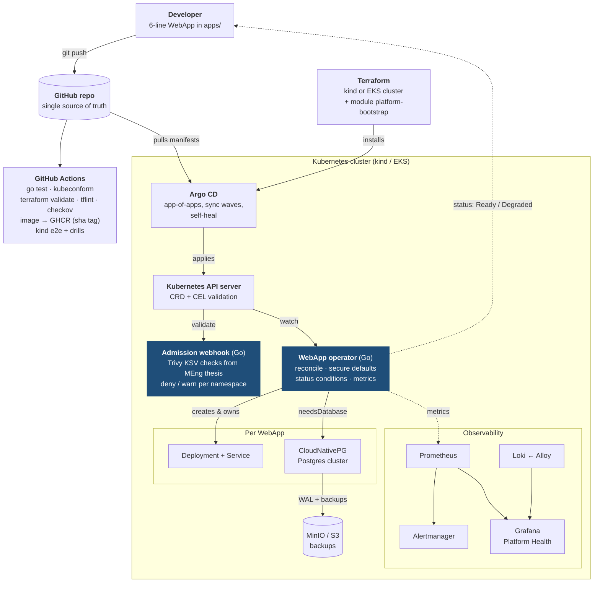

# Architecture

All phases are built (see [ROADMAP.md](../ROADMAP.md)). Source of the diagram: [architecture.mmd](architecture.mmd), rendered: [architecture.png](architecture.png).

## Request flow

1. **Developer** commits a six-line `WebApp` to `apps/`.
2. **GitHub Actions** runs Go tests, kubeconform, Terraform validate/tflint/Checkov, publishes a SHA-tagged operator image to GHCR and runs the kind e2e drills.
3. **Terraform** (`infra/envs/kind` or `infra/envs/eks`) creates the cluster and, through `modules/platform-bootstrap`, installs only Argo CD and the root app.
4. **Argo CD** syncs everything else from Git in waves: CRDs, cert-manager, CloudNativePG, monitoring, Loki/Alloy, the operator, then the WebApps; self-heal reverts manual drift.
5. **API server** validates the WebApp against the CRD schema and CEL rules (pinned image, port range).
6. **Admission webhook** checks Deployments/Pods against the Trivy KSV rules from my MEng thesis: deny in `enforce` namespaces, warn in `warn` namespaces.
7. **Operator** reconciles: Deployment + Service with secure defaults, a CloudNativePG cluster when `needsDatabase: true` (backups to MinIO/S3, `DATABASE_URL` injected once ready), status conditions and Prometheus metrics.
8. **Observability**: Prometheus scrapes the operator, Alertmanager fires `WebAppNotReady` / `OperatorDown` / `ReconcileErrorsHigh`, Alloy ships logs to Loki, Grafana shows "Platform Health".
9. **Drills** D1–D7 break each part on purpose and assert recovery.

## Design decisions

- **Edit children in place, don't replace them.** `mutateDeployment` sets only the fields the platform owns, and sets every probe field explicitly. Fields the API server defaults are left alone, so `CreateOrUpdate` writes only on real change. A unit test asserts the Deployment's resourceVersion is unchanged after repeated reconciles.
- **Selectors are set once.** They are immutable, so they're set only at creation and kept a strict subset of the labels.
- **Degraded is a first-class state.** A stuck rollout is not just "not ready yet": the operator inspects pods for reasons that won't fix themselves (ImagePullBackOff, CrashLoopBackOff, …) and reports them in the Ready condition, so developers see *why*.
- **Requeue while not ready.** Pod-level failures don't change the Deployment the controller watches, so a not-ready WebApp is re-checked every 10s.
- **Validation as early as possible.** Cheap rules (pinned image, port range) live in the CRD as OpenAPI/CEL, so bad specs are rejected by the API server before they reach the operator.
